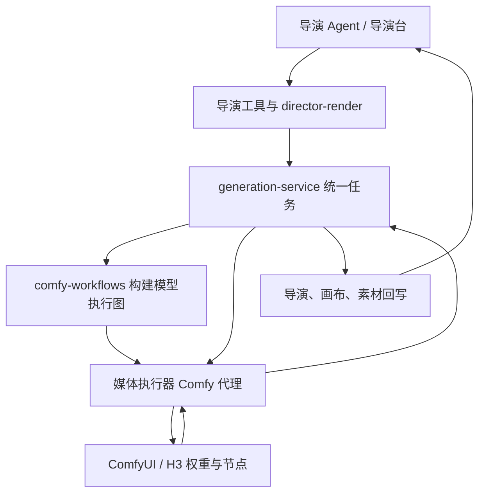
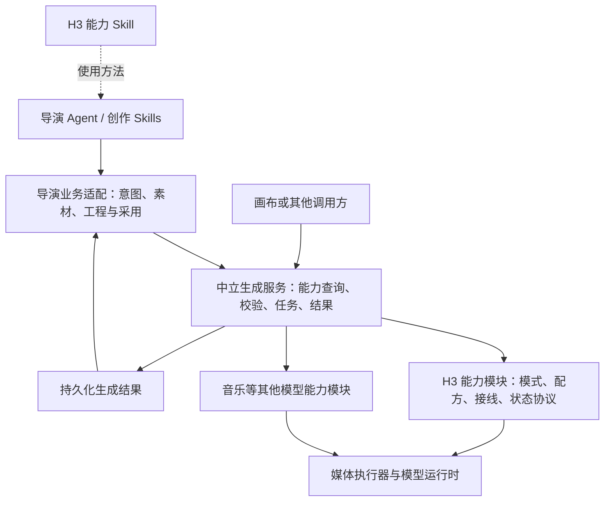

# 生成能力与导演台职责梳理

结论：保留现有应用服务和 GPU 执行器的部署方式，先分清代码与契约边界。H3 应是可独立迭代、验证和发布的模型能力；生成服务管理中立任务；Skill 教 Agent 正确使用能力；导演业务负责创作工程与结果采用。本次为现状审查和调整建议，未执行结构重构或运行时切换。

## 当前真实调用链

- `server/src/agent/scenes/index.ts` 注册场景工具和 Skills，`skill-registry.ts` 加载技能；导演和画布已经分场景，不应取消隔离。
- `server/src/director-render.ts#createDirectorShotGeneration` 同时处理导演工程校验、H3 模式选择、参考素材组装、配方、时长对齐、原生状态及任务绑定。普通 Ref2VA 要求整张故事板是导演业务规则，不是中立视频生成的必要条件。
- 当前最终视频提示由 `readDirectorVideoPrompt` 读取 `video-prompt.md` 正文原样发送；不能再按早期记录认定服务端仍从画格编译最终提示。代码已接入 PDD 配方选择，是否采用仍取决于能力可用性、参考条件和续接来源，不能仅据源码宣称正式运行时已启用。
- `server/src/generation-service.ts` 已统一管理任务落库、调度、取消、远端任务 ID、文件转存与进度；`runComfyGeneration` 在应用端构图，再通过执行器上传、提交、轮询和取回结果。
- `server/src/comfy-workflows.ts` 拥有多种模型的固定执行图，以及 H3 权重名、采样、帧对齐、引导和原生续接接线。当前 GPU 执行器主要负责代理、运行时探测及 GPU 排空恢复，并非所有工作流的实际拥有者。
- `media-executor/src/media_executor/app.py` 探测 `h3Runtime`、`h3PddRuntime`、节点及权重，执行 H3 GPU 调度；这些属于模型运行环境，不属于导演创作。
- 工作区存在未提交的 `director-v2.ts` 和 `director-file-contract.ts` 调整。本报告未修改它们，也不将新目录方案当成已经接入的事实。

## 已经混在一起的职责

| 位置 | 现状与影响 | 建议归属 |
| --- | --- | --- |
| `generation-service.ts#updateGeneration` | 直接调用导演、画布、素材、风格回写；通用任务核心随业务增加依赖，部分回写异常被吞掉 | 任务核心持久化结果；应用装配层调用业务处理器，业务回写需可重复执行和恢复 |
| `h3-continuation.ts#verifyRequestedH3Continuation` | 调用 `resolveDirectorH3Continuation` 并查询 `director_shots`；通用生成使用续接仍需导演项目和视频段身份 | 中立层验证文件所有权、来源生成、哈希与运行时兼容；导演层另外检查当前采用版本和创作依赖 |
| `director-render.ts` | 导演意图选择和 H3 执行参数计算放在同一路径，导演业务直接识别模型 ID 和 base/PDD 运行时 | 导演适配器决定任务意图和素材；H3 能力模块负责模式、输入限制、帧窗口、配方与指纹兼容 |
| `AiGenerationRequest.params` | `__directorSegment`、`__directorMusic` 等业务绑定与 `__h3*` 执行参数混装；导演工具还据这些字段查询任务 | 区分业务归属元数据与模型执行参数；业务元数据不传给模型执行图 |
| `directorMediaModels` | 只返回模型名、输出和大类输入，视频模式、引用预算、续接条件及配方限制没有完整提供给 Agent | 基于统一能力声明给 Agent 有界的模型能力详情；既有预检继续处理当前请求 |
| `director-generate-video-segments` Skill | 同时说明导演工程、H3 官方提示、音频参考、续接和任务查询 | 导演制作 Skill 保留工程规则；抽出可复用 H3 使用知识，由场景显式注册和组合 |

不能只搬文件：例如把 `h3-continuation.ts` 移到新目录，却仍要求 `projectId/segmentId`，依赖问题没有解决。

## 目标结构

### H3 独立能力

同一能力模块维护模型模式、实际可用的输入组合、配方、时长/帧数限制、状态兼容规则、执行图、输出解释及固定验证样例。运行时权重和节点仍部署在 GPU 执行器侧。独立迭代首先意味着明确源码、契约和版本归属，不要求马上新增独立服务器。

需要分别声明输入模式（首帧、首尾帧、多模态参考）、操作（新生成、状态续接）与配方（基础、PDD 等）。某一组合通过测试，不自动推广到其他组合。安装了节点、可以接收输入、通过质量验收也是三种不同状态。

H3 Skill 负责参考语义、官方提示格式、对白与声音计划、模式适用条件和常见失败的修订方式；不能决定文件权限、允许跳过参数校验或覆盖运行时事实。能力说明应注明实现/运行时版本，Skill 标明来源和适用范围。

### 中立生成服务

统一接收明确模型/能力、操作、最终提示、显式媒体引用、生成参数及可选续接状态句柄；返回任务、媒体、实际规格、运行时/配方快照、可续接状态和必要执行统计。模型特有参数保留有类型的扩展，不用最小公分母抹去多模态或续接能力。

外部调用方不能自行构造可信状态身份；服务端根据已拥有的文件和成功生成记录解析句柄。拆出导演依赖后仍须保留跨用户拒绝、文件篡改拒绝、模型/配方/分辨率不匹配拒绝和排队期间来源变化检查。导演段的“当前采用版本已变”由业务层另外验证。

已有任务表和结果存储继续使用。暂不引入消息总线、动态插件市场或全量数据迁移；业务回写先用明确注册的处理器，并沿用生成 ID 和版本校验处理重放与恢复。

### 导演业务与创作 Skills

决定叙事镜头、是否切镜/续接、素材选择、故事板及声音需求，保存最终提示和明确输入，调用能力后采用结果并维护工程依赖与时间线。H3 不要求服务知道“父亲”“女儿”是哪条数据库记录。

整张多宫格故事板仍是当前导演制作约定，但不能反向成为生成服务的全局门槛。续接是可选操作，普通长片可以由独立镜头剪辑而成。插帧、放大、独立配乐也应是各自的媒体能力，由 Agent 按实际缺陷和创作意图组合，不能自动串成每个项目的固定流水线。

普通图片遵循当前导演 Codex 的宿主原生生图约定；视频、声音及专用工作流继续使用现有服务。中立化不等于要求所有媒体改走一个供应商，也不等于给导演暴露画布工具。

## 最小实施顺序及验收

1. **先整理能力声明与查询。**复用现有目录、模型定义和运行时探测，统一给 Agent 返回模式、引用预算、配方条件、时长及续接限制。验收：Agent 能区分“原生生成对白”和“音频参考输入”，不会将 PDD 推荐给不适用的 FL2VA。
2. **划出 H3 模块及状态边界。**把 H3 构图、参数和配方逻辑集中；拆开通用状态验证与导演采用链验证。验收：不创建导演项目，仍可通过中立接口完成普通生成及原生续接；原有权限和篡改拒绝保持有效。
3. **拆开任务核心与业务回写。**导演、画布、素材处理器由应用入口装配，生成核心不再导入业务模块。验收：生成成功后业务回写失败不污染任务终态，刷新/重启恢复不丢结果、不重复采用，也不覆盖用户新编辑。
4. **整理能力 Skill 和导演制作 Skill。**复用官方参考与现有导演技能，消除重复和过时描述；保留场景工具权限边界。验收：Agent 读取能力、准备最终提示和引用，完成真实生成、审片修订及时间线采用，文件与实际请求一致。

以上各步都需要先通过针对性回归，再检查真实调用；不以目录整理或测试全绿宣称高质量长片已完成。本轮只给出审查与方案，未开始这四步的实施。
